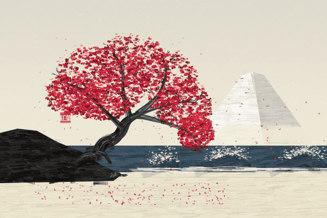
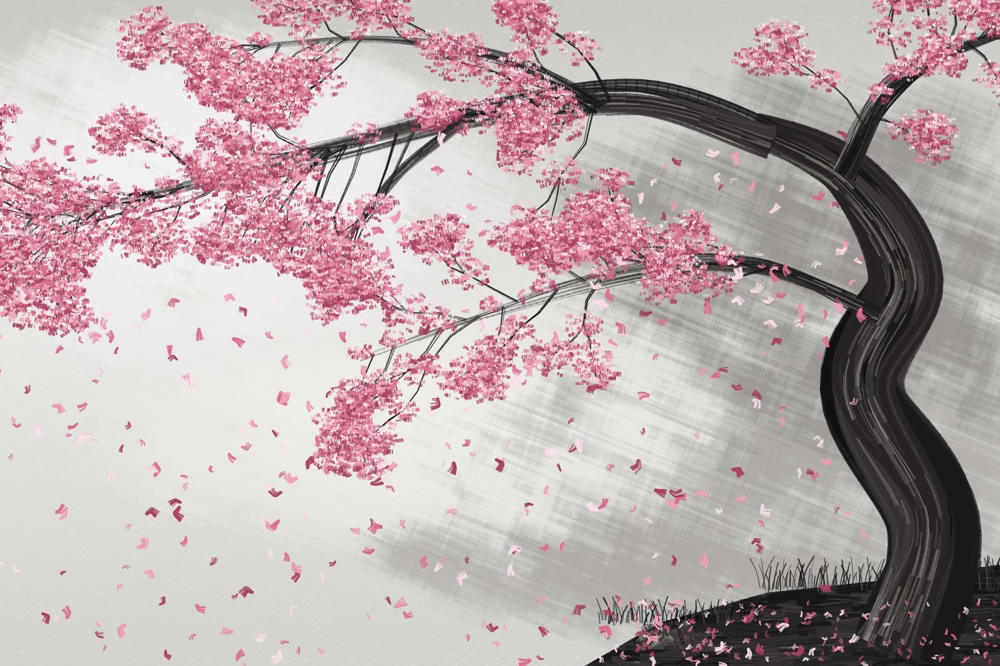
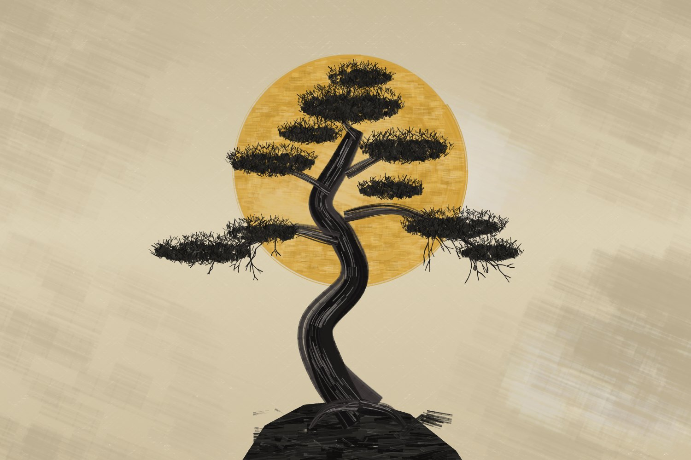
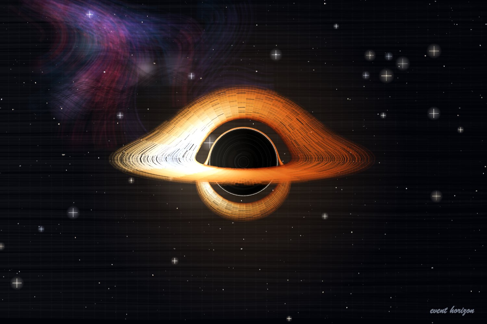
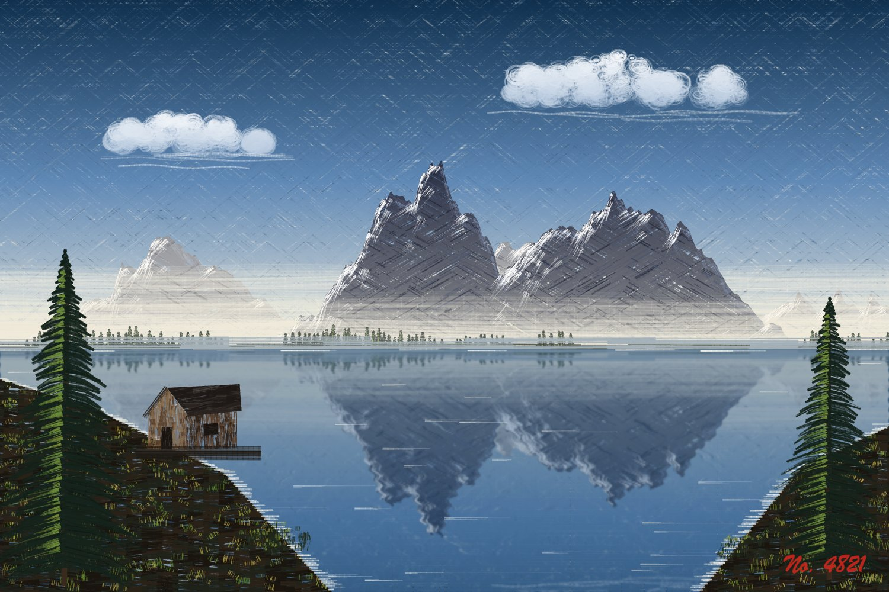
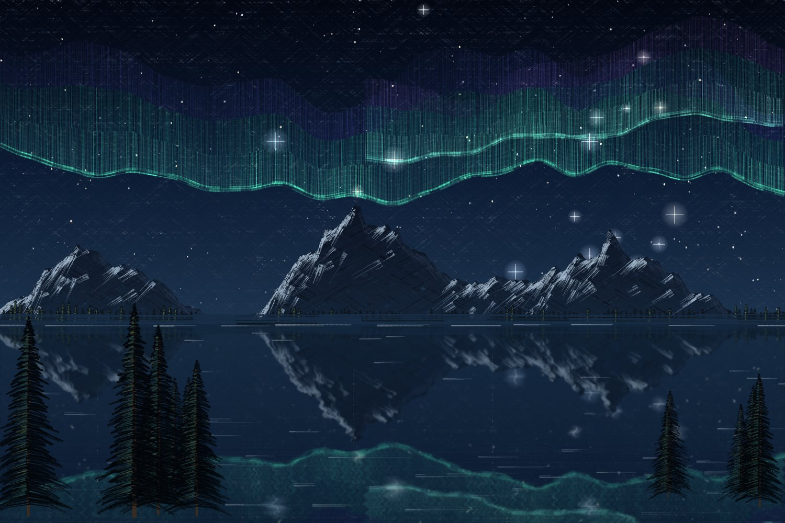
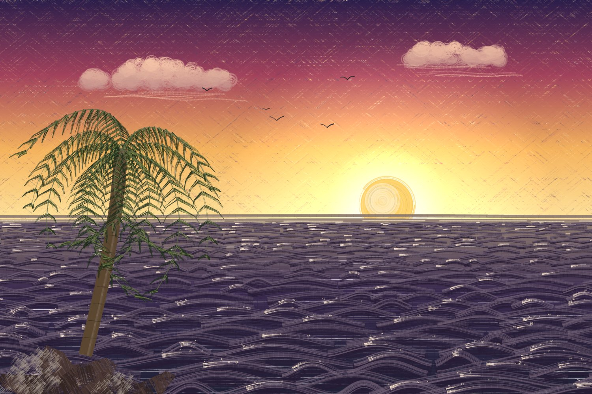
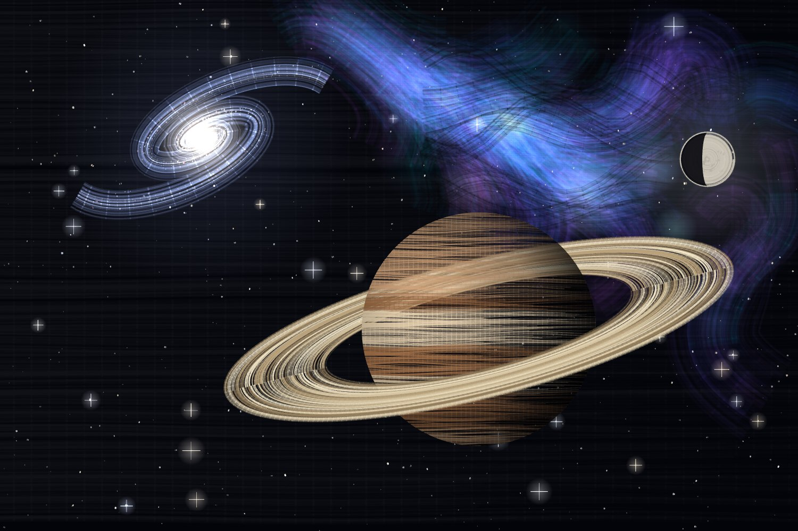
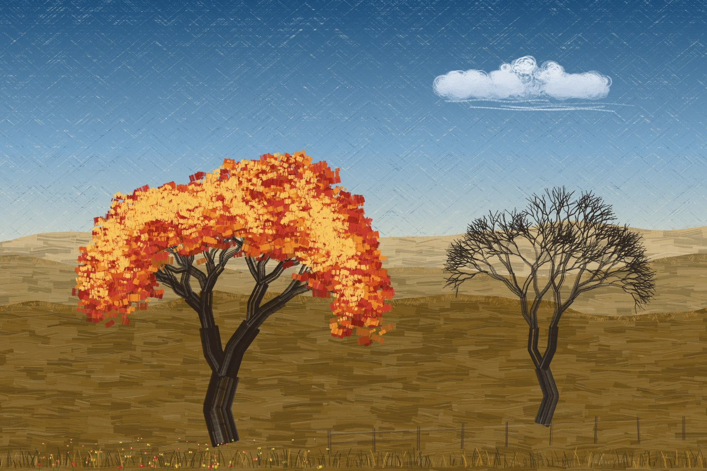

# Happy Little Pixels

An oil-painting studio that runs in the browser. Paint by hand with simulated bristle brushes, or write JavaScript that paints for you and watch it happen stroke by stroke.

**Try it: [manojshipra.github.io/pixel-oils](https://manojshipra.github.io/pixel-oils/)**

<p align="center"></p>

## Gallery

Every one of these is a few lines of code, painted with the same bristle brush. They're all in the app under *Start from*, and in [`templates/`](templates/).

| | | |
|:-:|:-:|:-:|
| <br>Windswept sakura | <br>Pine and gold moon | <br>Red tree and Fuji |
| <br>Black hole (ray traced) | <br>Mountain lake | <br>Northern lights |
| <br>Seascape | <br>Deep space | <br>Autumn |

This is all it takes for the pine:

```js
seed(17);
paper();
orb(760, 370, 255, { color: '#d2a03a' });
crag([[520, 1010], [575, 925], [660, 880], [780, 868], [890, 900], [990, 980], [1010, 1010]]);
limb([[790, 900], [720, 810], [690, 710], [765, 610], [745, 515], [700, 440], [740, 355], [775, 285]], 70);
const right = limb([[748, 470], [860, 455], [975, 500], [1060, 560]], 22);
twigs(right, 10, { angle: [0.6, 1.6], length: 45, width: 3 });
pinePad(985, 492, 115, 34);
// …a few more limbs and pads
```

## Run it

It's plain ES modules with no build step, but browsers won't load modules from `file://`, so serve the folder:

```bash
python3 -m http.server 8080
```

Then open http://localhost:8080. The code editor (CodeMirror) and fonts load from a CDN; without internet the editor falls back to a plain text box.

Because it's all static files, GitHub Pages can host it as is: Settings → Pages → deploy from the `main` branch, root folder.

## Two ways to paint

**Paint by hand**: six brushes (2-inch flat, fan, round, liner, palette knife, soft blender), 14 oil colours, mixing (Shift-click a second paint), and a *wet canvas* slider that makes strokes pick up the paint underneath. Pen pressure works.

**Paint with code**: write code in the editor and press ⌘/Ctrl + Enter. Your code runs once and records strokes; the player then paints them a few at a time so you can watch.

- **Library** tab: every helper with its options, an *Insert example* button and a *Try on canvas* button.
- **Sketches** tab: save and reopen your code (stored in this browser).
- Click the canvas to insert its `x, y` at the cursor. The status bar shows coordinates as you hover.
- Errors point at your line number.
- *Save PNG* downloads the painting.
- `templates/` has every starting point as its own `.js` file. Paste one into the editor, or into a sketch, to start from it.
- *● Record* saves a video (MP4 where the browser supports it, otherwise WebM) in 3:2, 1:1 or 9:16 reel shape. In code mode it runs your code and stops by itself 1.5 s after the painting finishes. In hand mode, press it again to stop.

## How it works

```
src/
  engine.js        the bristle brush, colour mixing, seeded randomness
  api/index.js     records your code's strokes into a queue
  api/core.js      stroke, line, dab, arc, curve, along, shape, drift, fill, paper, gradient, disc, glow, sign, seal
  api/sky.js       cloud, sun, moon, orb, stars, nebula, aurora, birds
  api/land.js      mountains, fuji, mist, hills, land, crag, beach, grass, flowers, rocks
  api/water.js     lake (real reflection of the canvas), waves, sea, breaker, waterfall
  api/trees.js     evergreen, forest, treeLine, bush, tree, sakura, maple, bareTree, palm,
                   limb, twigs, blossom, canopy, pinePad, petals (build any tree yourself)
  api/buildings.js cabin, fence
  api/space.js     blackHole (ray traced), planet, galaxy
  docs.js          the Library reference, also used for autocomplete
  presets.js       the starting points
  main.js          the UI
```

**The brush.** A stroke drags 2–70 bristles along a path. Each bristle keeps its sideways offset, so it leaves its own streak, and each runs out of paint at its own rate, which gives the dry-brush breakup.

**The black hole.** `blackHole()` traces light around a non-spinning (Schwarzschild) black hole. A photon's orbit obeys `u'' + u = 3u²` (u = 1/r, units of the hole's mass). For each point on the image it integrates that equation backwards from the camera (RK4) and records where the ray crosses the thin accretion disk: once for the direct image, and again half a turn later for the image lensed around the hole. It then paints along curves of equal disk radius (isoradials, the method Luminet used for the first black hole image in 1979). Brightness and colour come from the combined gravitational and Doppler shift, `g = √(1 − 3/r) / (1 + Ω·x·sin i)`, with intensity ∝ g⁴. That is why the side of the disk moving toward you is brighter. Options: `inclination`, `spin` (±1), `inner`/`outer` radius, `beaming` (0 turns Doppler off, as the film Interstellar did), `turbulence`, `roll`.

## Adding your own helper

Each file in `src/api/` exports `(k) => ({ ...helpers })`. `k` gives you `stroke`, `rand`, `noise`, every helper defined earlier, and `k.scene` (horizon colour, light direction). Add an entry to `docs.js` so it shows up in the Library and autocomplete.
